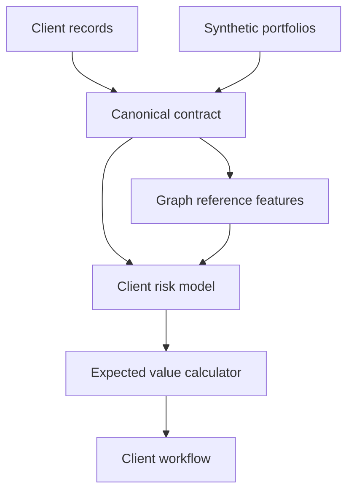

# Architecture

F4 is an embedded Python framework. It does not host data, make payment calls,
run KYC checks, or provide a case-management interface. The client owns storage,
compute identities, scheduling and access control.

The open core demonstrates contracts, synthetic data and economics. Production
decisioning requires validated probabilities, payoff estimates, point-in-time
features, policy controls and an auditable integration with the client's workflow.
Those responsibilities do not disappear because a Python calculation executes.

## Public boundaries

This repository may be published independently. It contains no commercial
detector library, tuned client thresholds, client data, prospect-specific material
or credentials. The synthetic generation parameters describe demonstration data,
not an operational anti-fraud policy.

Public and private code are separate distributions with separate license files
and namespaces. A public wheel has no dependency on the commercial wheel. Release
scripts check public paths before building; there is no automatic publishing
workflow.

## Reference sources

- [Python packaging guide](https://packaging.python.org/en/latest/guides/writing-pyproject-toml/)
- [Apache License 2.0](https://www.apache.org/licenses/LICENSE-2.0)

Domain design and equations follow the supplied F4 product specification dated
October 31, 2026. The original internal specification is intentionally excluded
from public release artifacts.
